# GitOps MCP Server

A local, read-only Git inspection server for the [Model Context Protocol](https://modelcontextprotocol.io). It exposes
status, history, diffs, blame, and search as typed tools that return JSON, so an assistant doesn't have to drive `git`
through a shell.

The server runs `git` for you in a subprocess and returns parsed results. Only git's read/inspect subcommands are
wired up, so the assistant can't mutate your repository through this server.

---

## Why use it?

| Without this server                                         | With this server                                      |
|-------------------------------------------------------------|-------------------------------------------------------|
| Assistant runs `git` through a shell (`Bash`/`run_command`) | Assistant calls typed tools with named parameters     |
| Output is raw text the model has to re-parse                | Output is JSON in a consistent envelope               |
| A bad argument could mutate or corrupt the repo             | Only inspection subcommands exist                     |
| Paths and refs flow straight to the shell                   | Paths are confined to the repo; refs are pre-verified |
| No limits on runtime or output size                         | 30 s timeout and 8 MB output cap on every call        |
| Hard to tell "no results" from "command failed"             | Distinct error codes for each failure mode            |

### What's in the toolset

`status`, `diff`, `log`, `show`, `blame`, `grep`, `ls-files`, `branch list`, `reflog`, and `stash` inspection.
There's no `commit`, `push`, `checkout`, `reset`, or any other writing subcommand aren't implemented.

Collection-returning tools wrap their payload in a uniform [result envelope](#the-result-envelope) carrying `count`,
`filters_applied`, `truncated`, `repo_root`, and (on failure) a structured `error`. The assistant can act on a
response without re-issuing the command to figure out what happened.

Argument handling is centralized. Tools declare a typed intent; one builder turns that intent into argv with a fixed
hardening prefix, an `--end-of-options` barrier, a scrubbed environment, and repo-confined pathspecs. See
[Security model](#security-model).

Every tool takes an absolute `cwd`. The server resolves the repo root via `git rev-parse --show-toplevel` (cached per
`cwd`), so the assistant doesn't need to know the repo layout.

---

## How a call works

Every tool runs through the same pipeline. The only things that change are which git subcommand fires and how the
output gets parsed.

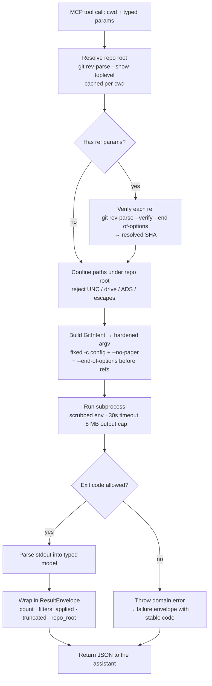

A few rules apply to every call regardless of tool:

- **Timeout**: 30 s wall-clock. If the subprocess runs longer, the process tree is killed and a `GitTimeout` error is
  returned.
- **Output cap**: 8 MB per stream, truncate-then-flag. Oversized output sets `truncated: true` on the envelope instead
  of blowing up memory.
- **stdout protection**: a sentinel guards the stdio transport so stray writes can't corrupt the MCP protocol stream.
  All logging goes to a file or stderr.

---

## Tool catalog

| Tool                                  | Purpose                                                   | Key parameters                                                                                     |
|---------------------------------------|-----------------------------------------------------------|----------------------------------------------------------------------------------------------------|
| [`git_status`](#git_status)           | Working-tree status snapshot                              | `cwd`                                                                                              |
| [`git_diff`](#git_diff)               | Unified diff (staged / ref-to-ref / worktree / stat-only) | `cwd`, `staged`, `fromRef`, `toRef`, `paths`, `contextLines`, `statOnly`                           |
| [`git_log`](#git_log)                 | Commit history with filters                               | `cwd`, `paths`, `author`, `since`, `until`, `grep`, `pickaxe`, `maxCount`, `ref`, `follow`, `perlRegex`, `allRefs` |
| [`git_show`](#git_show)               | Inspect one commit/tag/tree + its diffs                   | `cwd`, `ref`, `paths`                                                                              |
| [`git_file_at_ref`](#git_file_at_ref) | One file's content, mode, and blob id at a ref            | `cwd`, `path`, `ref`, `lineStart`, `lineEnd`, `byteOffset`, `maxBytes`                             |
| [`git_blame`](#git_blame)             | Per-line author/commit/time for a file                    | `cwd`, `path`, `lineStart`, `lineEnd`, `ref`                                                       |
| [`git_grep`](#git_grep)               | Search tracked content (optionally at a ref)              | `cwd`, `pattern`, `paths`, `globs`, `excludePaths`, `ref`, `ignoreCase`, `fixedString`, `maxCount`, `countOnly` |
| [`git_ls_files`](#git_ls_files)       | List tracked paths (optionally with mode and blob id)     | `cwd`, `paths`, `globs`, `excludePaths`, `stage`                                                   |
| [`git_branch_list`](#git_branch_list) | List local (and optionally remote) branches               | `cwd`, `includeRemote`                                                                             |
| [`git_reflog`](#git_reflog)           | Recent reflog entries                                     | `cwd`, `maxCount`                                                                                  |
| [`git_stash_list`](#git_stash_list)   | List stash entries                                        | `cwd`                                                                                              |
| [`git_stash_show`](#git_stash_show)   | Diff for a single stash entry                             | `cwd`, `index`                                                                                     |

---

## Tool details

### `git_status`

Returns a working-tree snapshot built from porcelain v2 with `-z` (NUL-delimited) output, plus branch and ahead/behind
information. The result is parsed from a known format rather than scraped from human-readable text.

The payload groups changes into `staged`, `unstaged`, and `untracked` lists and includes `branch`, `upstream`, `ahead`,
`behind`, and an `is_clean` flag.

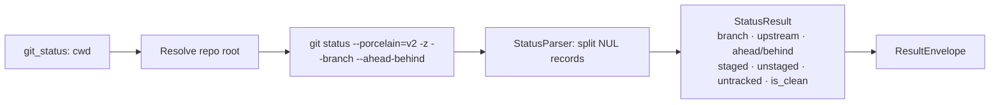

---

### `git_diff`

Returns a unified diff in one of four modes, picked by the parameters you pass (precedence:
`stat_only` > `ref_to_ref` > `staged` > `worktree`):

- **worktree**: unstaged changes (default)
- **staged**: index vs `HEAD` (`staged: true` adds `--cached`)
- **ref_to_ref**: `fromRef` to `toRef` (any branch/tag/SHA; `toRef` defaults to the working tree)
- **stat_only**: per-file add/delete counts and change kind, no patch text

`fromRef` also accepts a git range expression: `A..B` (two-dot, the same diff as `fromRef: A, toRef: B`)
or `A...B` (three-dot, the diff from the merge base of `A` and `B` to `B`). A range must be the sole ref;
combining a range with `toRef` returns a `RejectedArgument` error. Each side of the range is verified to a
SHA before use, exactly like a plain ref.

Each diff runs two passes: the patch itself (or `--name-status` for stat-only) and a companion `--numstat -z` pass.
The two are merged into one `DiffResult` so every file carries both its hunks and its line counts. `contextLines`
maps to git's `-U<n>`. Every pass runs with `--no-color`, so a `color.ui` or `color.diff` setting of `always` in your
git config cannot put escape codes in the patch.

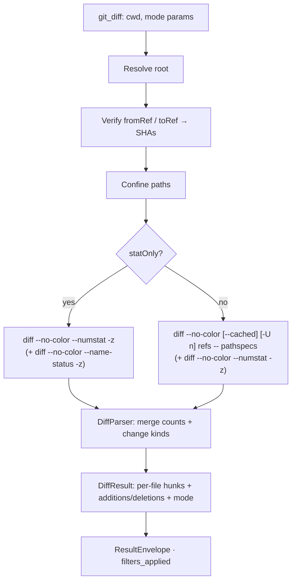

---

### `git_log`

Returns commits matching the given filters, parsed from a fixed `--pretty=format` directive into `Commit` records
(hash, short hash, author, authored/committed timestamps, relative time, subject, body, parents).

Filters: `author`, `since`, `until`, `grep` (message match; a basic regular expression by default, passed as
`--basic-regexp` so a `grep.patternType` in the user's or the repository's git config does not change it;
`perlRegex: true` switches `grep` and `author` to Perl-compatible regular expressions, the dialect `git_grep`
uses, so `A|B` alternation and `\d` work; a git without PCRE2 returns `PcreUnavailable`, as for `git_grep`),
`pickaxe` (`-S`, find when a string was added or removed), `paths`, `ref` (start point, or a range `A..B` /
`A...B` to list the commits one ref adds over another), `allRefs` (walk every ref under `refs/` plus `HEAD`;
cannot be combined with `ref`), `follow` (track renames, only when scoped to a single path), and `maxCount`
(default 50).

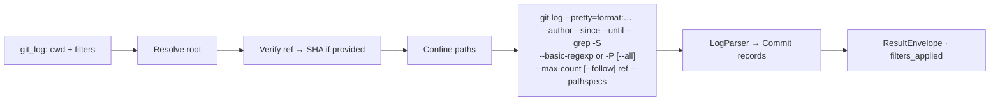

---

### `git_show`

Inspects a single ref (commit, tag, or tree) and returns its metadata along with per-file diffs. The ref is required
and is verified to a SHA before use.

Runs two passes: a one-commit `git log` for metadata (same format as `git_log`), and `git show --format=` for the
patch, parsed into the same `FileDiff` shape as `git_diff`. `paths` restricts the diff section. Every pass runs with
`--no-color`, so a `color.ui` or `color.diff` setting of `always` in your git config cannot put escape codes in the
patch.

A `ref` in `<rev>:<path>` form (`HEAD:README.md`, `:README.md`, or `HEAD:` for the root tree) names a file or tree,
not a commit, and is rejected with a
`RejectedArgument` that points at `git_file_at_ref`. A colon inside `@{...}` or `^{...}` is part of the commit-ish,
and `:/text` (commit search by message) is accepted.

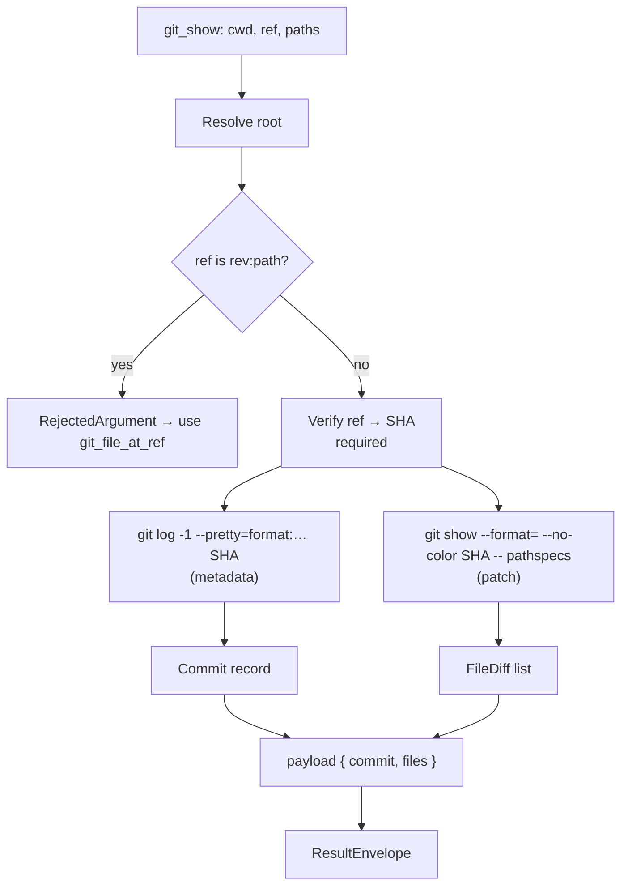

---

### `git_file_at_ref`

Returns one tracked file's content as of a ref, the equivalent of `git show <ref>:<path>`. `ref` defaults to `HEAD`
and takes any commit-ish; the file goes in `path`, never inside `ref`. A file deleted since is still readable at an
earlier ref.

The payload is `{path, ref_sha, mode, object_id, size, total_lines, next_byte_offset, is_binary, content}`. `size` is
the blob's byte count and `total_lines` its line count: the number of `\n` bytes, plus one when the blob is not empty
and does not end in `\n`. A blob with a NUL byte in its first 8000 bytes (git's own binary heuristic) comes back with
`is_binary: true` and `content`, `total_lines`, and `next_byte_offset` all `null`. A `120000` entry is a symlink, and
its content is the link target text.

Three optional parameters cut a large text blob down to what the client can take. They apply in this order, on the
raw bytes git returned, before decoding:

- `lineStart` and `lineEnd` (1-based, inclusive, both or neither, the same contract as `git_blame`) keep only those
  lines, each with its `\n`. An end past the last line is clamped to it. A start past the last line is
  `RejectedArgument` with `param: line_range` and `total_lines` in the detail, so the caller can retry; an empty blob
  has no lines, so any range on it is rejected.
- `byteOffset` (0-based) skips that many bytes of what the range kept, or of the whole blob without a range. An
  offset that lands inside a multi-byte UTF-8 character moves forward to the next character. An offset at or past
  the end is `RejectedArgument` with `param: byte_offset` and `content_bytes` (the length it was checked against) in
  the detail. An offset of 0 on empty content returns empty content.
- `maxBytes` caps the returned content in UTF-8 bytes. A cut that lands inside a character backs off to the start of
  that character, so a cap of 4 or more never splits one; a smaller cap always keeps at least one byte, so paging
  with it still advances. A cut sets the envelope's `truncated` to `true` and `next_byte_offset` to the offset of the
  first byte left out, in the frame `byteOffset` uses: pass it back as `byteOffset`, with the same range and cap, to
  read the next page. Without a cut, `next_byte_offset` is `null`.

There is no default cap: without these parameters the whole blob comes back, and a file of tens of kilobytes on one
line can exceed an MCP client's per-result limit. Pass `maxBytes` for a large or single-line file. `\r` stays in the
content. `total_lines` and the past-the-end checks see only the bytes git returned, so for a blob over the 8 MB output
cap `total_lines` is a lower bound. A binary blob ignores a valid range, offset, and cap. A half-specified or reversed
range, a start below 1, a negative offset, or a cap below 1 is `RejectedArgument` before git runs, whatever the blob
turns out to be.

Committed content is returned as-is: git-ops has no secret denylist or content scan, the same trust class as the
hunks `git_show` returns and the lines `git_grep` returns.

Errors: `PathNotFound` when the path does not exist at that ref, `RejectedArgument` (with `param`) when `path` is
empty, names a directory or the repository root, when `ref` is a `<rev>:<path>` expression or a blob id, or for the
range, offset, and cap cases above (`line_range`, `byte_offset`, `max_bytes`).

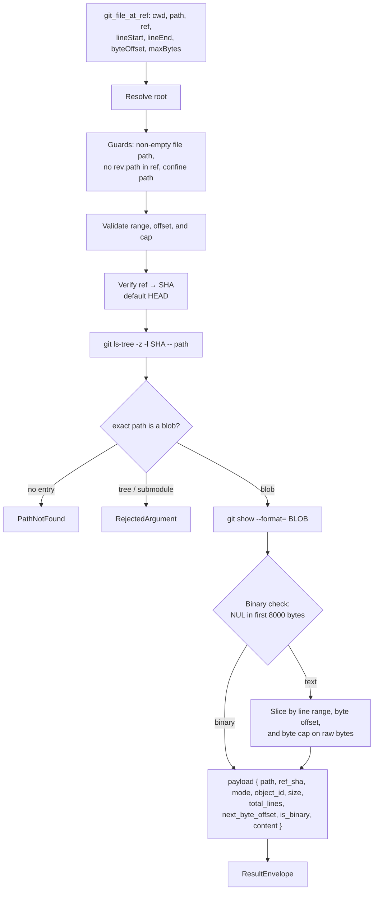

---

### `git_blame`

Returns per-line attribution (author, commit, timestamp) for one file, optionally restricted to a `lineStart`–`lineEnd`
range and optionally at a specific `ref`. Uses `--porcelain` output for parseability. The line range is validated
(`start >= 1`, `end >= start`); invalid ranges return a `RejectedArgument` error.

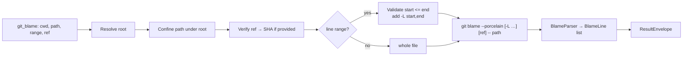

---

### `git_grep`

Searches tracked content, optionally at a historical `ref`, so you can grep a past revision without checking it out.
Uses `-n -z` (line numbers, NUL-delimited), or `-c -z` in count mode, plus `--no-color`, so a `color.ui` or
`color.grep` setting of `always` in your git config cannot put escape codes in paths and line numbers.

- `fixedString` (default `true`) → literal search (`-F`).
- `fixedString: false` → Perl-compatible regex (`-P`), so `\s`, `\w`, `\d`, and bare quantifiers work the way callers
  expect.
- `ignoreCase` → `-i`; `maxCount` → per-file match cap (`-m`).

Exit code 1 ("no matches") is treated as success. If git was built without PCRE2, asking for regex returns a
`PcreUnavailable` error rather than silently looking like "no results".

`countOnly: true` (git's `-c`) returns one `{path, match_count}` entry per file instead of every matching line, so a
broad pattern comes back as a short list. `match_count` counts matching lines, not occurrences: a line with the
pattern twice counts once. Files with no matching line are left out, so `count` on the envelope is the number of
files that matched. git applies `-m` before it counts, so `maxCount` together with `countOnly` is `RejectedArgument`
(`param: max_count`) rather than a capped count.

Three parameters choose which files are searched, and they combine:

- `paths` → literal repo-relative paths. A file matches itself; a directory matches its whole subtree.
- `globs` → wildcard patterns. Wildcards follow git's default pathspec matching: `*` and `?` also match `/`, so
  `*.cs` matches at any depth and `crates/*/*/Cargo.toml` works.
- `excludePaths` → paths or wildcard patterns to drop (git's `:(exclude)` magic). A directory drops its subtree. With
  no `paths` and no `globs`, the search covers every tracked file except the excluded ones.

A file is searched when it matches some `paths` or `globs` entry (or both lists are empty) and no `excludePaths`
entry. A `paths` entry with `*`, `?`, or a leading `:` is rejected with `RejectedArgument` (`param: paths`); put the
pattern in `globs` or `excludePaths`. A `globs` or `excludePaths` entry must be repo-relative with `/` separators and
must not start with `:` or `-` or contain a `..` segment.

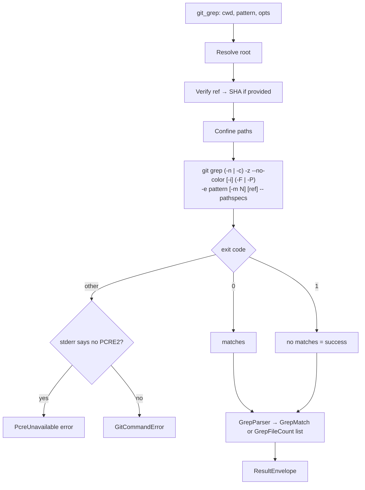

---

### `git_ls_files`

Lists tracked paths, optionally restricted to a subset of repo-relative paths. NUL-delimited output parsed into
entries. Useful for enumerating what's under version control before drilling in.

By default each result is a path string. With `stage: true` the tool runs `git ls-files --stage` and each result
becomes an object `{path, mode, object_id, stage}`: `mode` is the six octal digits git stores (`100644` for a
regular file, `100755` for an executable one, `120000` for a symlink, `160000` for a submodule), `object_id` is the
staged blob, and `stage` is 0 for a normal entry or 1 to 3 for the sides of an unmerged one. That is how to check
whether a committed script carries the executable bit.

`paths`, `globs`, and `excludePaths` select entries the same way as in [`git_grep`](#git_grep). Wildcards follow
git's default pathspec matching: `*` and `?` also match `/`, so `globs: ["*.json"]` lists every tracked `.json` file
at any depth, and `excludePaths: ["docs"]` drops everything under `docs/`. A `paths` entry with `*`, `?`, or a
leading `:` is rejected with `RejectedArgument`.

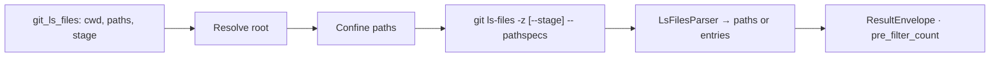

---

### `git_branch_list`

Lists local branches, and remotes when `includeRemote: true`. Uses `git for-each-ref` with a unit-separator (`\x1f`)
format so each branch yields its refname, HEAD marker, object name, upstream, and subject parsed into `Branch` records.

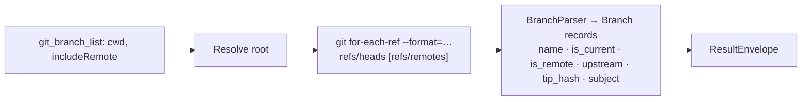

---

### `git_reflog`

Returns recent reflog entries (`maxCount`, default 50), each with `hash`, `short_hash`, `selector`, `subject`, `when`,
and a human `relative_time`. Useful for recovering lost work or following recent HEAD movement.

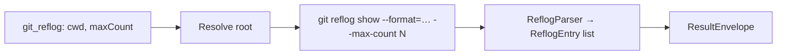

---

### `git_stash_list`

Lists stash entries with selector, subject, and timestamp via `%gd%x1f%gs%x1f%at`, parsed into `StashEntry` records.

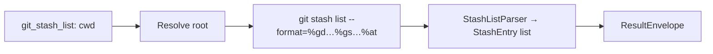

---

### `git_stash_show`

Returns the diff for a single stash (`index`, 0 = most recent) as a `DiffResult`, using the same two-pass
patch + `--numstat -z` assembly as `git_diff`. A negative index returns a `RejectedArgument` error. Every pass runs
with `--no-color`, so a `color.ui` or `color.diff` setting of `always` in your git config cannot put escape codes in
the patch.

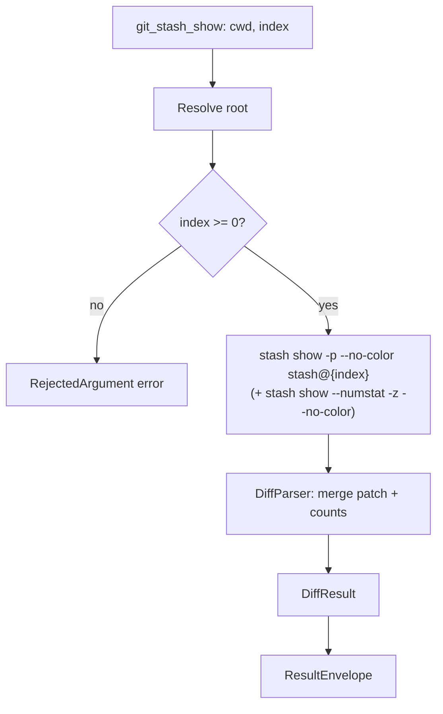

---

## The result envelope

Every collection-returning tool wraps its payload in this structure:

```jsonc
{
  "results": [ /* typed items: commits, file diffs, blame lines, … */ ],
  "count": 12,                 // results.length
  "pre_filter_count": 12,      // count before any post-filtering (when relevant)
  "filters_applied": {         // echo of which filters were in effect
    "author": "<redacted>",    // user-controlled values are redacted, not echoed
    "max_count": 50
  },
  "truncated": false,          // true if git output hit the 8 MB cap, or a tool-level cap cut the payload (git_file_at_ref maxBytes)
  "repo_root": "/abs/path/to/repo",
  "error": null                // populated only on failure (see below)
}
```

On failure, `results` is a well-formed empty list and `error` carries a structured object:

```jsonc
{
  "results": [],
  "count": 0,
  "error": {
    "code": "RefNotFound",                  // stable, machine-readable
    "message": "ref not found; try git_branch_list or git_log",
    "detail": { "param": "ref" }            // never contains user data / paths
  }
}
```

### Error codes

| Code                | Meaning                                  |
|---------------------|------------------------------------------|
| `GitCheckError`     | Generic base error                       |
| `GitNotInstalled`   | `git` not found / failed to start        |
| `NotAGitRepository` | `cwd` is not inside a work tree          |
| `RefNotFound`       | A ref could not be resolved              |
| `AmbiguousRef`      | A ref resolved ambiguously               |
| `PathNotFound`      | A path does not exist                    |
| `PathOutsideRepo`   | A path escaped the repository root       |
| `RejectedArgument`  | An argument failed shape validation      |
| `InvalidArgument`   | Argument names/types did not fit schema  |
| `GitTimeout`        | The subprocess exceeded the 30 s timeout |
| `GitCommandError`   | git exited non-zero for another reason   |
| `PcreUnavailable`   | Regex requested but git lacks PCRE2      |

Client-facing error detail is data-free (exit code, parameter name). The scrubbed git stderr tail is logged
server-side only, since it can echo user-controlled paths or refs.

An `InvalidArgument` reports a call whose argument names or types did not fit the matched tool's schema, so
the tool never ran; its failed result sets `IsError = true`, where git-ops runtime errors leave it unset.
An unknown name is rejected with a `did_you_mean` when a schema name is close, `detail.missing_required`
lists any required name left out (a `git_status` with no `cwd`, say), and `detail.expected_arguments` lists
every name the tool accepts. A known name sent with the wrong JSON type reports the same code once the names
check out. Only argument names are echoed back, never values.

---

## Security Model TL;DR

- TL;DR:
  - This server lets an AI assistant *read* your Git history but never *change* it, and it's built so that even a buggy or hostile assistant can't turn a "look" into damage.
  - Read-only by design, no shell to exploit, confined to your repo, and hardened against malicious repositories. The section below is the same story with the technical details.

- Still TL;DR, but with more info:
  - **It can only read.** Commands that alter a repo (commit, push, checkout, reset, delete) aren't in this server at all. There's no setting to flip; the dangerous verbs were simply never built.
  - **There's no shell to trick.** The assistant never gets a command line. It fills in a form (which tool, which file, which commit), and the server assembles the real `git` command itself. Old tricks like hiding `; rm -rf` inside a filename go nowhere, because nothing interprets them as commands.
  - **It stays inside your repo.** Every file path is pinned to the repository folder. Attempts to climb out of it, reach network shares, or touch hidden file streams are rejected.
  - **Every input is treated as suspect.** Branch and commit names are checked against the real repo before use, and nothing the assistant sends can be mistaken for a secret command-line option.
  - **Git itself is locked down.** Auto-running scripts (hooks), password prompts, and credential helpers are switched off, and the command runs in a stripped-down environment, so a booby-trapped repo can't hijack it.
  - **It can't run away.** Each call is capped at 30 seconds and 8 MB of output, then stopped: no runaway processes, no memory blowups.
  - **It doesn't leak.** Error messages and logs are scrubbed of your file names, search terms, and paths.

As is with all in-house security solutions: This is not perfect, and I might be unknowingly be re-inventing the wheel. But it's a best-effort type of thing. I'll gladly accept feedback and suggestions to improve it.

---

## Security model (long version)

The assistant never sees a shell and never builds a command line. Untrusted input: `cwd`, refs, paths, patterns, and
filter values is handled in stages:

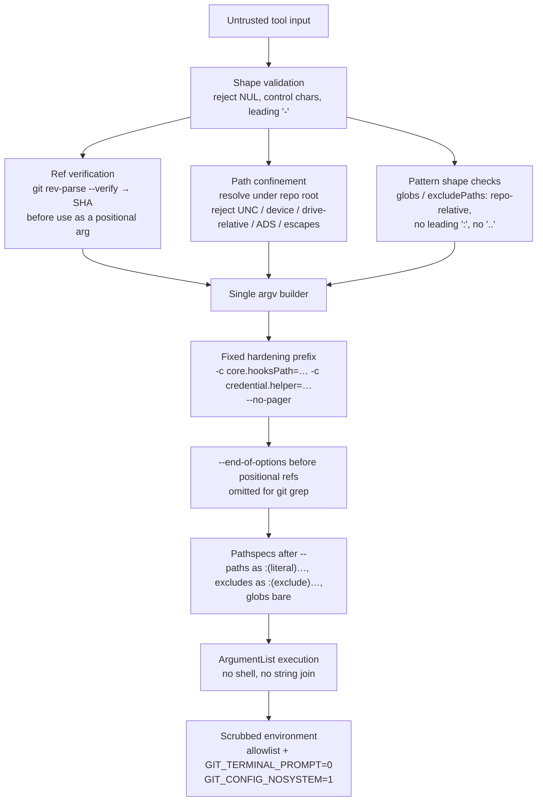

- **One argv producer.** Tools declare a typed `GitIntent`; a single `GitCommandBuilder` is the only code that
  serializes it to argv. It prepends fixed `-c` neutralizers (disable hooks, pager, fsmonitor, credential helpers,
  askpass, auto-gc, signature verification) and, before any positional ref, inserts `--end-of-options` so no user
  value can be read as an option (git grep excepted: its pattern is a glued `-e` token and its refs are pre-resolved
  SHAs). `log.showSignature=false` is there because verifying a signed commit runs the program `gpg.program`,
  `gpg.ssh.program`, or `gpg.x509.program` names, and a repository's own config can set both keys; a forged signature
  is enough.
- **Refs are verified, not trusted.** Any ref is resolved to a SHA via `git rev-parse --verify --end-of-options <ref>`
  before it's used.
- **Paths are confined.** Each path is resolved under the repo root and rejected if it uses a UNC, device, or
  drive-relative prefix, an NTFS alternate data stream, or otherwise escapes the root. The result is a repo-relative
  POSIX path placed after `--` as a `:(literal)` pathspec, so wildcards in it are plain characters.
- **The server chooses all pathspec magic.** Every pathspec carries a prefix the server chose:
  `:(literal)` for `paths`, `:(exclude)` for `excludePaths`, and none for `globs` (git's default wildcard matching).
  Git reads magic only up to the server's closing `)`, so a value such as `:(top)../x` inside a literal or exclude
  item is pattern text. A bare value (a glob, or `git_blame`'s file argument) may not start with `:`, the only place
  git looks for magic. `globs` and `excludePaths` are shape-checked rather than confined: they must be repo-relative
  with `/` separators and must not contain a `..` segment. Grep and ls-files match pathspecs only against tracked
  entries, so a wildcard or exclude changes which tracked files match and nothing else.
  Pattern matching cost is bounded by the 30 s timeout, the same bound that applies to user regexes.
- **No shell.** The subprocess is started with an explicit argument list, not a joined string, so shell
  meta-characters can't leak.
- **Scrubbed environment.** The child env is built from a small allowlist (`PATH`, locale vars, `HOME`, plus a few
  Windows essentials) with fixed git neutralizers added. Everything else is dropped.

Two paths are still open. A filter driver that a repository's config names (`filter.<driver>.clean` or
`filter.<driver>.process`, matched through a `filter` attribute) can run when git reads a worktree file for
`git_status`, a worktree `git_diff`, or `git_blame` without `ref`; the `suspicious_filter_invocation` Warning reports
one that fails. In a partial clone, reading a missing object makes git start a fetch from the promisor remote, which
can run a program the repository's config names (`remote.<name>.uploadpack`, `core.sshCommand`).

---

## Logging

Structured JSON logs (allowlisted fields only, no user data) go to a rotating file, falling back to stderr if the file
can't be opened. stdout is reserved for the MCP protocol.

| Variable               | Purpose                                       | Default                                 |
|------------------------|-----------------------------------------------|-----------------------------------------|
| `MCP_GITOPS_LOG_FILE`  | Log file path                                 | `mcp-gitops.log` next to the executable |
| `MCP_GITOPS_LOG_LEVEL` | `TRACE`/`DEBUG`/`INFO`/`WARN`/`ERROR`/`FATAL` | `INFO`                                  |

Files rotate at 10 MB, keeping 5 backups. On shutdown the server writes a `server_stop` summary with session metrics
(call counts, cache hit rate, truncations, timeouts).

---

## Building from source

TODO: Add instructions to build on Windows, macOS, and Linux.

---

## Requirements

- **`git` on `PATH`**: required. This server runs your system `git` for every call; without it, tools fail with a
  `GitNotInstalled` error. Any reasonably recent `git` works.
- **.NET runtime**: *not* needed for the released binaries. Each release ships a self-contained, single-file
  executable per platform ([Releases and verification](../../README.md#releases-and-verification)), so there's nothing
  extra to install to run it.
- **Building from source**: the [.NET 10 SDK](https://dotnet.microsoft.com/download).

---

## Adding this server to Claude Code

The server is a .NET console app that speaks MCP over stdio. It needs `git` on `PATH`; the released binary is
self-contained, so no separate .NET runtime is required (see [Requirements](#requirements)).

Add an entry to your MCP configuration (e.g. `.mcp.json` at your project root, or via `claude mcp add`). On Windows:

```jsonc
{
  "mcpServers": {
    "git-ops": {
      "command": "c:\\path\\to\\git-ops.exe",
      "args": [],
      "env": {
        "MCP_GITOPS_LOG_FILE": "Z:\\logs\\mcp-gitops.log",
        "MCP_GITOPS_LOG_LEVEL": "INFO"
      }
    }
  }
}
```

> On macOS/Linux, drop the `.exe` suffix and use forward-slash paths.

### Verifying the connection

After adding the server, restart Claude Code and run `/mcp` (or `claude mcp list`) to confirm `git-ops` is connected.
The tools appear as `git_status`, `git_diff`, `git_log`, and so on. Each call needs an absolute `cwd` inside a git
repository. Claude Code supplies the working directory automatically.

> Quick note: This project follows the MCP protocol, so this tool should work with any AI agent.

---

## Project layout

```
RaccoonNinja.McpToolset.Server.GitOps/
├─ Program.cs            # stdio host bootstrap (logging → MCP wiring → sentinel → run)
├─ Tools/                # one class per MCP tool + ToolCommon (shared pipeline)
├─ Security/             # GitIntent, GitCommandBuilder, path/arg validation, env builder
├─ Repo/                 # repo-root resolution (cached) + ref verification
├─ Runner/               # hardened subprocess runner (timeout + output cap)
├─ Parsers/              # NUL/porcelain parsers → typed models
├─ Models/               # Commit, DiffResult, BlameLine, Branch, StashEntry, …
├─ Envelope/             # ResultEnvelope / ErrorEnvelope + filters builder
├─ Errors/               # error-code taxonomy + domain exceptions
└─ Logging/ · Metrics/   # allowlist JSON logging, stdout sentinel, session metrics
```

## Example of instructions to use this MCP

You can check [this repo](https://github.com/brenordv/claude-skill-set/blob/master/skills/brain/knowledge/git-readonly-operations.md) to see an example of prompt structure to tell your agent to use this MCP server.
